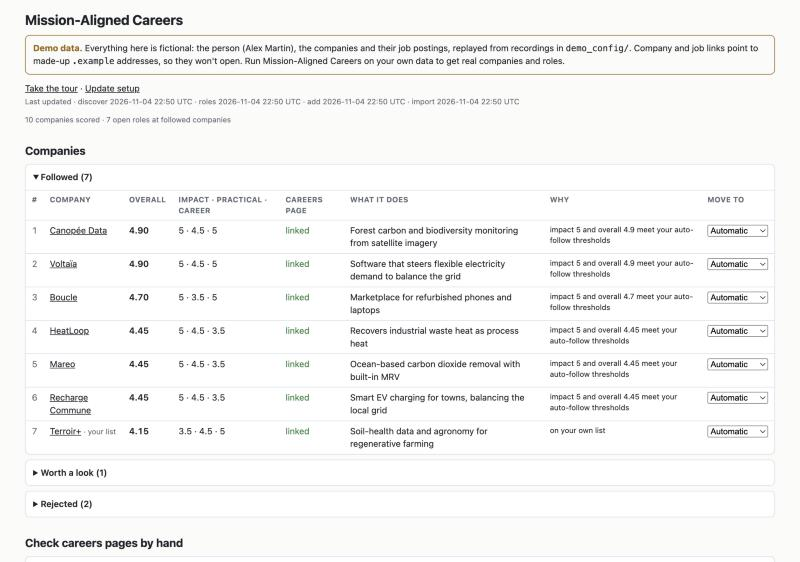
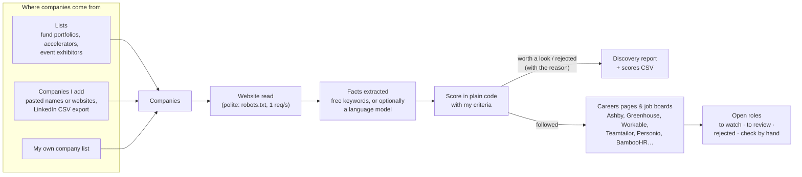
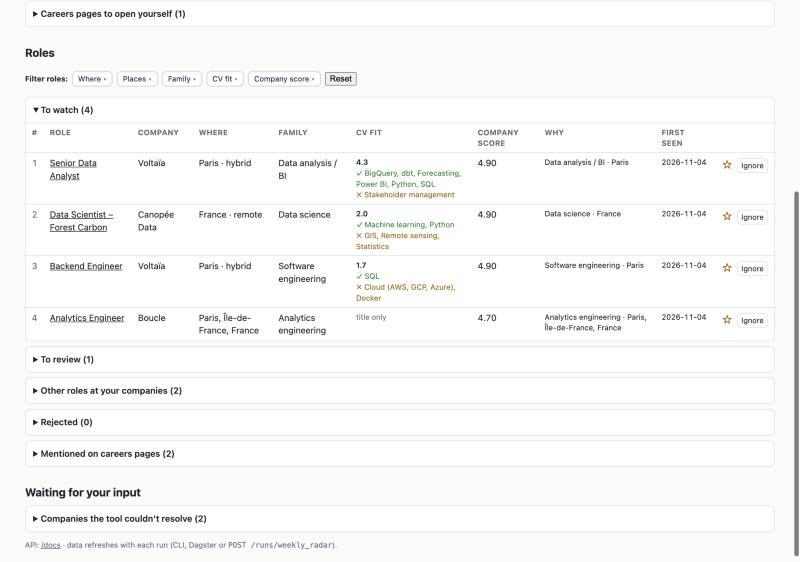

# Mission-Aligned Careers

[](https://github.com/lauramcr/mission-aligned-careers/actions/workflows/ci.yml)

Mission-Aligned Careers finds **companies and roles I wouldn't find on my own**. It reads lists of companies, scores each one against my personal criteria, and watches the job boards of the best ones for roles that match my experience. Everything comes together in one dashboard of companies and roles. The engine is generic: what counts as a good match comes from configuration files.

The dashboard, with the companies the tool followed and why:



## Background

I want to work for a company whose mission I share. In climate and environment, that covers a huge range of sectors, and job boards don't filter by mission. Going through investors' portfolios, accelerator cohorts and event exhibitor lists by hand, then each company's careers page, is slow. This tool does two things:

- **Finds new companies** on those lists and scores how well each one matches what I'm looking for.
- **Watches open roles** at the companies worth following and ranks them by how well they fit my CV.

**On my own data so far** (three weeks, free keyword matching, no language model): 6 lists read, 510 companies scored (29 followed, 324 worth a look, 155 rejected), 30 careers pages and job boards watched, 189 roles tracked. For example, it narrowed Norrsken's Impact/100 list of 419 companies down to 7 to follow and 49 more to review, so I review a short list instead of the whole page.

## How it works



- **Facts first, then scores.** For each company the tool extracts facts (what it does, its sector, where it operates), by default with free keyword matching. **Plain, tested code then computes the scores** from my criteria.
- **Only what is due is re-read**: job boards every 7 days, websites and lists every 30.
- **Polite fetching**: robots.txt is respected and each site gets at most one request per second. Sites that block tools are listed for me to check by hand.

## Try the demo

You need [uv](https://docs.astral.sh/uv/) (it installs Python 3.12+ for you). Then:

```bash
git clone https://github.com/lauramcr/mission-aligned-careers.git && cd mission-aligned-careers
uv sync              # install
uv run radar demo    # opens the demo's setup page in your browser (Ctrl+C to stop)
```

The demo is the real tool, run for a **fictional** person: Alex Martin, a data analyst in Paris (`demo_config/`). It opens on Alex's setup page, read-only, with a short tour. Click *Run the demo* at the bottom: the tool runs the same steps as on real data, then *Go to dashboard* shows the results. Web pages, job boards and model answers are **replayed from recordings**, so the demo needs no account and no internet connection, and gives the same result every time. The companies are fictional, so their links point to made-up `.example` addresses that won't open.

What you'll see:
- where Alex's companies come from: 1 company on Alex's own list, 7 companies Alex met at an event, and more found on a climate fund's portfolio page that the tool reads;
- 2 companies waiting for a website, for Alex to complete;
- every company scored: followed, worth a look, or rejected with the reason;
- open roles sorted into *to watch*, *to review*, *other*, *rejected* and *check by hand*.

The roles Alex should watch, ranked by CV fit and company score:



`uv run radar demo --no-serve` runs the demo in the terminal only, without opening a page.

**With Docker:** `docker compose up` runs the demo, then serves the dashboard and API at http://localhost:8000 and Dagster (the scheduler) at http://localhost:3000. To use your own data instead, run `cp .env.personal.example .env` first. In Docker, companies are scored with keyword matching only, because Claude Code can't sign in inside a container.

## Run it on your own data

After installing (`git clone` and `uv sync`, as above), start with the setup page:

```bash
uv run radar setup    # opens your setup page in your browser
```

**The setup page** collects what the tool needs to make recommendations for you. The first time, it creates your private `config/` folder from `config_templates/`; this folder is never committed. Each step has its own *Save* button, and nothing you saved is deleted. If something isn't valid, the page refuses it and says why. The steps:

1. **Your CV** (PDF, Word, Markdown or text). It's copied to `config/`; older CVs are moved to `config/old_cvs/`.
2. **What you're looking for**:
   - where you live, other places within reach, and where remote roles may be based;
   - fields of interest: the most important ones, and others that are also OK;
   - sectors you would never work for;
   - kinds of roles you want, and kinds you never want;
   - contracts you won't take;
   - the types of organisation you'd join;
   - what matters most: mission first, balanced, or career first.

   Other settings in `config/criteria.yaml` have sensible defaults, explained in [docs/SETUP.md](docs/SETUP.md).
3. **Lists to follow**: pages listing companies, such as fund portfolios, accelerator cohorts or rankings. Keep the suggested ones and add your own.
4. **Companies you follow**: type them into the table, paste names or websites, or upload a CSV such as LinkedIn's *Company Follows* export.
5. **Waiting for your input**: companies the tool couldn't find a website for. Add the website and they join your list.

When you're done, click **Save all and run**. The tool reads your lists and the companies' websites, scores every company, reads the job boards of the ones it follows, and shows its progress on the page. *Go to dashboard* then opens your results.

**Later runs.** Run it again from the setup page, or from the terminal:

```bash
uv run radar start    # runs everything that is due, then opens your dashboard
```

It only re-reads what is due, so later runs are much faster than the first one. `--force` re-reads everything now. It stops if there is nothing to score yet, and warns you if there is no CV. Every step is logged to `data/logs/radar.log`; `uv run radar --verbose start` also shows each web request on screen. The dashboard is at http://localhost:8000.

**Run it automatically every week.** Start Dagster, the scheduler, in a terminal and leave that terminal open:

```bash
./scripts/dagster-dev.sh    # opens Dagster at http://localhost:3000 (Ctrl+C to stop)
```

Then, in Dagster, go to *Automation* and switch on `weekly_radar_schedule`. It runs the same steps as `radar start` every Monday at 07:00 (Paris time), but only while Dagster is running and your computer is awake. Avoid starting a run from the setup page while Dagster is running one: the database accepts one run at a time.

<details>
<summary><b>Experimental:</b> use a language model for better facts (not yet tried on real data)</summary>

By default, no language model is used: facts come from free keyword matching. This is rough, so nothing is followed automatically and good matches land in *worth a look*. With `--use-llm` (e.g. `uv run radar start --use-llm`), the tool uses **Claude Code** with your Claude subscription (no API key), reading at most 40 websites per run. This route is built and tested with recorded answers, but not yet tried on real data; see [docs/LLM.md](docs/LLM.md).

The model receives company names, websites and website text, plus the list of themes and kinds of roles to choose from (including terms you added). It never sees your CV or your preferences, and it only extracts facts: the scores are always computed by plain code. Every run says which mode it uses.

</details>

### What you get

- **Company lists**: followed, worth a look, and rejected (with the reason). Each company's menu moves it to another list (*Follow*, *Worth a look*, *Reject*, or *Automatic* to let the rules decide). Your choice is saved in `config/decisions.csv`. From the terminal: `uv run radar decide google reject`.
- **Role lists**, by role family (20 families, recognised from English and French job titles):
  - **To watch**: one of your role families, a contract you accept, within reach of where you live.
  - **To review**: your family but located elsewhere, an internship that hints at an open application, or a role from another family that your CV fits on at least 3 specific skills.
  - **Other roles at your companies**, and **Rejected** roles (contracts or families you excluded).
  - When many open roles fall in a family that isn't yours, the tool suggests adding or excluding it.
- **CV fit**: each role's skills are matched against your CV ("CV fit 4.3 · matches SQL, dbt · missing Stakeholder management") and roles are ranked by it. Each list shows 5 roles per company; the rest are one click away.
- **Check by hand**: good companies whose jobs the tool can't read (no careers page, LinkedIn only, a site that blocks tools, a page that needs JavaScript), with the link and the reason. Mark each one *Checked* (hidden for 30 days), *Ignore*, or *Reject company*.
- **Your marks**: ☆ saves a role, and it stays saved after the advert closes; *Ignore* hides a role. Kept in `config/roles.csv` and `config/careers_checks.csv`.
- **Filters** on the dashboard: where (within reach, remote OK…), places, role family, CV fit and company score. Your browser remembers them.
- **Your own terms** beyond climate (e.g. *Biotech*, *Gambling*), with the words to look for, kept in `config/my_vocabulary.yaml`.
- **Company locations without a model**, found by matching countries, regions and cities in lists, websites and job adverts.

### Where things are kept

Everything stays on your computer. The database `data/radar.duckdb` records when each list, website and job board was last read, so a run skips what is recent. `data/cache/` keeps a copy of each page for 12 hours; after that the tool only asks the site whether the page changed. After each run, cached pages the run didn't need and older than 45 days are deleted.

| Folder | What it holds | Committed? |
|---|---|---|
| `config/` | yours: CV, criteria, lists, companies, decisions, marks | **never** |
| `config_templates/` | starting files for `config/` | yes |
| `demo_config/` | the fictional demo person, and the recordings that let the demo run offline | yes |
| `data/` | database, reports, scores CSV, cache, logs | **never** |

## Analytics in SQL

SQL views on the pipeline's tables answer questions about it (`storage/migrations/010_analytics_views.sql`):

| View | Question |
|---|---|
| `v_source_funnel` | Which lists bring good companies? Per list: companies → scored → followed / worth a look / rejected → job boards → open roles |
| `v_roles_by_week` | How fast do roles appear and close? New and closed roles per week |
| `v_board_health` | Which job-board types fail? Boards per type, failing ones, failure rate, open roles |
| `v_llm_usage` | What did the model cost? Calls, failures, tokens, cost and time per run and purpose |

```bash
uv run radar db query "SELECT source_name, companies, followed, open_roles FROM v_source_funnel ORDER BY followed DESC"
```

## Stack and data engineering

| Concern | How |
|---|---|
| Language & packaging | Python 3.12+, uv, src layout; Pydantic v2 models |
| Ingestion | 7 job-board feeds (JSON, XML, RSS), schema.org data, list pages, sitemaps, CSV exports, free text; httpx with robots.txt, per-host rate limits, retries and an ETag-aware cache |
| Normalisation | one `Company` / `JobPosting` schema; stable keys (`company_id` = registered domain, `job_id` = `ats:slug:id`) |
| Incremental & idempotent | due-only refresh, re-runs change nothing, `first_seen` / `last_seen` / closed roles |
| Enrichment | facts behind one interface (keywords, replay, or Claude Code), versioned by prompt + content hash; scores in plain code |
| Storage | DuckDB, numbered SQL migrations, analytics views, run metadata (`pipeline_runs`, `llm_calls`, site status) |
| Orchestration | Dagster assets, weekly schedule, data-quality checks |
| Serving | FastAPI dashboard and API, Markdown reports, CSV export, Typer CLI |
| Quality | ~790 tests (pytest + respx, recorded real responses as contract tests), ruff, mypy `--strict`, pre-commit |
| Delivery | Docker (multi-stage, non-root), compose, GitHub Actions on Python 3.12 and 3.13: lint → types → tests → demo → image |

Design decisions: [docs/ARCHITECTURE.md](docs/ARCHITECTURE.md). A map of the code with walk-throughs: [docs/CODE_TOUR.md](docs/CODE_TOUR.md).

## Limits

- **Keyword facts are rough.** Without a model there are many ties and some misses, and context is lost: a company "fighting oil drilling" gets an *oil & gas* flag (keyword facts flag, but never exclude). Pasted text is read line by line, so one company name per line works best.
- **Websites can be wrong.** For a bare name, websites are guessed (`name.com`, `name.fr`) and only offered as suggestions; even a verified site can belong to a company with the same name.
- **Duplicates.** Companies are identified by their website's domain, so a rebrand or a country site can appear twice.
- **Some job pages can't be read**: pages that need JavaScript, sites that block tools (LinkedIn, Welcome to the Jungle), Greenhouse's EU region, Rippling. They go to *check by hand*.
- **CV fit is skills overlap.** Skills missing from the vocabulary aren't seen, experience level isn't weighed, and some job boards publish titles only (Workable, BambooHR).
- **Runs on one machine.** The weekly schedule only fires while Dagster is running, and DuckDB allows one writer at a time, so the API answers "busy" during a run.
- **Partial history.** Company scores are overwritten at each run, and raw responses aren't kept.
- **One domain** (climate) so far, and only one language model route (Claude Code), not yet tried on real data.

## Next steps

- Better CV matching: a model extracts skills from CVs and adverts (code still computes the score), and seniority is taken into account.
- Track applications; a weekly "what's new" email.
- Find companies similar to the best ones (their investors' portfolios, fund job boards).
- Merge companies found under several names or websites, and record where each website came from.
- More model routes (a local model, Wikidata for websites) and sources (the France Travail API).
- Pipeline: keep raw responses, a data-quality report per run, monitoring and alerts, score history, running in the cloud.

## Reference

### Commands

```bash
uv run radar                                     # setup checklist and the next step
uv run radar setup                               # your setup page
uv run radar start [--use-llm] [--force]         # run what's due, then open the dashboard
uv run radar demo                                # the demo
uv run radar add "Patagonia" https://www.ikea.com              # add companies by name or website, scored now
uv run radar add --file "Company Follows.csv"                  # LinkedIn export (Settings → Data privacy)
uv run radar add https://patagonia.com --watch --note "met at ChangeNOW"   # straight to your own list
uv run radar decide google reject --note "too big"             # follow · review · reject · auto
uv run radar companies scores --outcome review --top 30
uv run radar companies find-careers              # try /careers, /jobs… where no careers page is known
uv run radar profile check                       # check your criteria file
uv run radar db query "SELECT * FROM job_postings LIMIT 5"
```

### Dagster (scheduling)

`./scripts/dagster-dev.sh` starts Dagster at http://localhost:3000; it keeps running until you press Ctrl+C. `radar setup` and `radar start` don't start it. It has two jobs: `weekly_radar` (the same run as `radar start`) and `find_careers` (manual only: tries /careers, /jobs… where no careers page is known). The schedule `weekly_radar_schedule` (Mondays 07:00, Paris time) is **off by default**: switch it on under *Automation*. You can also start either job by hand with *Materialize*. Checks warn when more than 25% of job boards or 20% of websites fail. Run history is kept in `data/dagster/`. To use Claude Code in scheduled runs, start it with `JOB_RADAR_USE_LLM=1 ./scripts/dagster-dev.sh`.

### API

`radar start` also serves an API at http://localhost:8000; try it at http://localhost:8000/docs.

| Endpoint | What it does |
|---|---|
| `GET /` | the dashboard |
| `GET /companies?outcome=review&careers_page=missing&limit=50` | scored companies, best first |
| `GET /companies/{company_id}` | one company (e.g. `patagonia.com`) |
| `POST /companies/{company_id}/decision` `{"decision": "review"}` | follow / review / reject / auto |
| `GET /roles?bucket=watch` | open roles, best CV fit first |
| `POST /roles/{job_id}/mark` `{"saved": true}` | save or ignore a role |
| `POST /companies/{company_id}/careers-check` `{"status": "checked"}` | checked / ignored / `null` |
| `POST /add` `{"companies": ["https://google.com", "Some Name"]}` | add companies and score them in the background |
| `POST /runs/weekly_radar` | ask Dagster to run a job |
| `GET /health` | health check |

While a run is using the database, read endpoints answer 503 ("a run is using the database").
