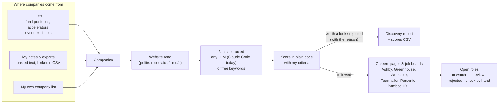

# Mission-Aligned Careers

A data pipeline that **finds companies and roles I wouldn't find on my own**, scores how well
each company fits my personal criteria, and watches their job boards for the roles that match
my experience. The first domain is climate & environmental impact; the engine itself is
generic and config-driven.

## Project background

While looking for a job, I came to the realisation that current job boards weren't adapted to
my needs. A strong personal criterion in my job search is that I want to align with the
general mission of my future company.

Being personally interested in climate mitigation, adaptation and environmental impact, the
impact areas and sectors I could work in cover a huge range.

Manually looking through different job boards, then through each company with a relevant post,
is slow and time-consuming — and the time lost means missing out on great opportunities.

I identified two places where I could automate the task:

- **Finding new companies.** There are many lists of companies I could look through: climate
  investors' portfolios, climate start-up accelerators, companies attending green-tech events.
  Going through all of them by hand takes too long. This tool grades how interesting each
  company may be to me, based on my personal criteria.
- **Monitoring relevant open roles.** Closer to what job boards offer: once a list of relevant
  companies is compiled, the tool automatically sifts through their job adverts to find the
  roles most relevant to my experience.

## How it works



- **A language model is optional, and it only extracts facts** (what a company does, its
  sector, where it operates); **plain, tested code computes the scores** from my criteria. The
  model never sees my preferences. Any model can be plugged in: [docs/LLM.md](docs/LLM.md).
- **Everything runs on a schedule** (Dagster, weekly) and only re-reads what is due: job boards
  every 7 days, websites and lists every 30.
- **Nothing is fetched impolitely**: robots.txt is respected, one request per second per site,
  and sites that block tools are listed for me to check by hand.

## Try it: the offline demo (3 commands, no account)

```bash
git clone https://github.com/lauramcr/mission-aligned-careers.git && cd mission-aligned-careers
uv sync                       # install (Python 3.12+ and uv: https://docs.astral.sh/uv/)
uv run radar demo --open      # the whole flow on a fictional world, in a few seconds
```

The demo follows a **fictional** person, Alex Martin, a data analyst in Paris
(`demo/cv.md`). Web pages, job boards and model answers are **replayed from recordings**, so it
needs no network, no account and gives the same result every time:

1. **Profile** — Alex's CV → criteria (`demo/criteria.yaml`): target roles, impact themes, weights.
2. **Notes → list** — messy event notes in English and French (`demo/paste.txt`) → 7 companies,
   plus a fund, an accelerator and an event suggested as new lists to read.
3. **Scores** — websites read, facts extracted, every company scored: followed, worth a look,
   or rejected with the reason (no climate theme, excluded sector).
4. **Jobs** — careers pages found, job boards read, roles sorted into *to watch / to review /
   rejected / check by hand*. Reports in `demo-run/reports/`, scores in `demo-run/scores.csv`.

Then look under the hood:
```bash
./scripts/dagster-dev.sh      # http://localhost:3000 — asset lineage, runs, data checks
./scripts/api-dev.sh          # http://localhost:8000 — ranked tables · /docs — the API
./scripts/ci.sh               # every CI check: lint, types, ~580 tests, demo, Dagster
```

### Or with Docker (one command)

```bash
git clone https://github.com/lauramcr/mission-aligned-careers.git && cd mission-aligned-careers
docker compose up             # demo, then Dagster (:3000) and the API (:8000)
```

`docker compose up` runs the offline demo, then starts the **Dagster UI** on
http://localhost:3000 and the **API** on http://localhost:8000 (ranked tables of companies and
roles, with Alex's CV fit) and http://localhost:8000/docs, all on the demo data.
In Dagster, *Materialize all* re-runs the weekly pipeline on the demo world, still offline.
Reports land in `demo-run/`. `docker compose down` stops everything.

> **This is demo data.** The person, companies and job postings are fictional and replayed from
> `demo/`. Company and job links point to made-up `.example` addresses, so they won't open —
> the dashboard and the reports say so too.

**Demo or your data — who decides?** The `JOB_RADAR_*` environment variables
(`src/job_radar/settings.py`). With no `.env` file, `compose.yaml` points them at `demo/` and
`demo-run/` and replays recordings. To run the containers on your own data instead,
`cp .env.personal.example .env` first: `config/` and `data/`, the live web, and keyword facts
(Claude Code can't log in inside the container; run `radar` on your machine for model facts).
Outside Docker (`radar …`, `./scripts/dagster-dev.sh`) no variables are set, so it always
uses your own `config/` and `data/`.

## Use it for your own search

**A language model is recommended, not required.** It turns pasted notes into company lists,
finds websites (with web search) and extracts company facts. Without one, the tool still
runs on free keyword-based facts (rough, low confidence, never followed automatically) and a
simple line-by-line parser for pasted lists.

- **Claude Code** is the model route implemented today: it uses a Claude subscription, no API
  key — [docs/USING_WITH_CLAUDE.md](docs/USING_WITH_CLAUDE.md).
- **Any other model** (a local one, another provider) plugs in behind three small
  interfaces — [docs/LLM.md](docs/LLM.md).

Check which mode is active at any time:

```bash
uv run radar doctor           # model route · criteria valid · lists · database
```

Then:

```bash
cp config/criteria.example.yaml config/criteria.yaml   # your preferences (gitignored)
cp config/sources.example.yaml config/sources.yaml     # lists to read (gitignored)
# paste your CV (text or Markdown) into config/cv.md   # ranks roles by skills fit (gitignored)
uv run radar profile check                             # validate your criteria
uv run radar add --text "$(pbpaste)"                   # paste notes: companies → scored
uv run radar discover --limit 20                       # read lists, score companies
uv run radar companies scores --csv data/scores.csv    # ranked, opens in Excel / Numbers
uv run radar roles                                     # open roles, ranked by CV fit
./scripts/api-dev.sh                                   # http://localhost:8000: ranked tables
```

**CV fit.** Each role's title and description are matched against the skills in your CV (a
skills vocabulary in the pack: SQL, dbt, Power BI, GIS, carbon accounting… in English and
French): *"CV fit 4.3 · matches SQL, dbt, Python · missing Stakeholder management"*. Roles are
ranked by it inside each list; it never moves a role between lists. The CV is read at every
run — replace or edit `config/cv.md` and everything is re-matched — and it never leaves your
machine (no model sees it).

What is sent to a model, and what never is: [docs/LLM.md](docs/LLM.md) and
[docs/USING_WITH_CLAUDE.md](docs/USING_WITH_CLAUDE.md). Your criteria, notes, lists,
decisions, CV and database are personal and never committed.

## Stack

| Layer | Tools |
|---|---|
| Language & packaging | Python 3.12+, uv, `pyproject.toml` (src layout, installable with pip) |
| Domain models & validation | Pydantic v2 |
| Ingestion | httpx (retries, backoff, rate limits, ETag cache), BeautifulSoup, tldextract |
| Fact extraction (optional LLM) | pluggable interfaces; Claude Code implemented (`claude -p` with JSON schemas) · replay · keywords (no model) |
| Storage | DuckDB, numbered SQL migrations |
| Orchestration | Dagster (assets, weekly schedule, data-quality checks) |
| Serving | FastAPI + Uvicorn, Markdown reports, CSV export, Typer CLI |
| Quality | pytest + respx, ruff, mypy `--strict`, pre-commit |
| Delivery | Docker (multi-stage, non-root), docker compose, GitHub Actions (CI + image on ghcr.io) |

## Where the data engineering is

| Concern | How |
|---|---|
| Ingestion | 7 job-board feeds (JSON, XML, RSS), embedded schema.org data, list pages, sitemaps, CSV exports, free text; polite HTTP (robots.txt, 1 req/s per host, retries with backoff, ETag-aware cache) |
| Normalisation | one `JobPosting` / `Company` schema; contract, remote, seniority, salary vocabularies; stable keys (`company_id` = registered domain, `job_id` = `ats:slug:id`) |
| Incremental & idempotent | due-only refresh (jobs 7 days, websites / lists 30 days), re-runs change nothing, `first_seen` / `last_seen` / closed roles |
| Enrichment | LLM extracts facts behind one interface (Claude Code, replay, or free keywords); outputs versioned by prompt + content hash; plain code computes scores |
| Storage | DuckDB, migrations, run metadata (`pipeline_runs`, `llm_calls`, website / board status) |
| Orchestration | Dagster assets, weekly schedule, manual-only jobs, data-quality checks |
| Serving | Markdown reports, CSV export, FastAPI |
| Quality | pytest (recorded real responses as contract tests), ruff, mypy `--strict`, pre-commit |
| Delivery | GitHub Actions on every push: lint → types → tests → demo → image build + smoke test; version tags publish the image |

Design decisions and their trade-offs: [docs/ARCHITECTURE.md](docs/ARCHITECTURE.md). A guided
map of the code (packages, tables, three walk-throughs): [docs/CODE_TOUR.md](docs/CODE_TOUR.md).

## Limits of this solution

- **Fact quality depends on the model.** Without one, facts come from keywords: rough, many
  ties in the ranking, some false negatives. With a model, facts are much better but use its
  quota (capped per run with `--limit`). Only Claude Code is implemented as a model route so
  far; others follow [docs/LLM.md](docs/LLM.md).
- **Keywords don't understand meaning.** Without a model, a company "fighting oil extraction
  and drilling" mentions oil & gas, so it gets an *oil & gas clients* flag (a warning, never an
  exclusion: keyword facts can't exclude a company). A model reads the context and gets it
  right in most cases; my follow / reject decisions always win.
- **Free text needs a model.** Without one, pasted text is read line by line: a line such as
  "spoke to notpla who replace plastic" becomes one (wrong) company name. One company name or
  link per line works.
- **Websites can be wrong.** Without a model with web search, websites for bare names are
  guessed (`name.com`, `name.fr`…) and only offered as suggestions; even a verified site can
  belong to a namesake (Oris the start-up vs Oris the watchmaker).
- **The same company can appear twice** under different names or websites (a rebrand, a
  country site, "Back Market" vs "BackMarket" on another domain): companies are keyed by
  website domain, and there is no alias table yet.
- **Some job pages can't be read automatically**, by design or by necessity: pages that only
  show jobs with JavaScript (e.g. Notion), sites that block tools (LinkedIn, Welcome to the
  Jungle), sites whose robots.txt says no, Greenhouse boards hosted in its EU region (no
  public feed), Rippling. They are listed under *check by hand* with the link.
- **CV fit is skills overlap, not understanding.** It counts which of a job's named skills
  (from the pack's vocabulary) the CV has: a skill missing from the vocabulary isn't seen,
  and experience level isn't weighed. Several job boards don't publish descriptions in their
  feeds (Workable, BambooHR), so those roles are "title only". The CV is read as plain text /
  Markdown (no PDF yet).
- **It runs on my Mac.** The weekly schedule only fires while Dagster is running and the Mac
  is awake. DuckDB allows one writer at a time, so the API answers "busy" during a run.
- **History is partial.** Job postings keep first / last seen dates, but company scores are
  overwritten each run and raw responses are not kept yet (see next steps).
- **One domain pack so far** (climate), and criteria are edited as a YAML file.

## Next steps

For the tool:
- **Better CV matching**: a model to extract skills from CVs and job ads (same rule: it
  extracts, code scores), seniority and years of experience, PDF CVs.
- A **UI** to review companies and roles and follow / reject them in one click.
- **Track roles** I'm interested in or have applied to.
- **A weekly "what's new" report / email**: only the roles that appeared, careers pages that
  changed, and companies waiting for my input. An earlier version existed as
  `radar run-weekly` (a Markdown digest); it was folded into the roles report to keep one
  weekly output, and can be recovered from git (`git show 9e4af36:src/job_radar/notify/markdown.py`).
- **Find similar companies** to the best-scoring ones (their investors' portfolios, fund job
  boards).
- **Company aliases**: merge the same company found under different names or websites.
- **Website confidence**: record where each website came from (list link, my CSV, model
  search, guess) and show the uncertain ones for confirmation.
- **Free-text fallback without a model**: an offline name recogniser, so pasted prose finds
  "Notpla" without an LLM (it still couldn't tell a fund from a start-up).
- **More model routes**: a local model (e.g. Ollama) and a free website lookup (Wikidata) —
  see [docs/LLM.md](docs/LLM.md).
- **More sources**: the France Travail job-offers API.

For the pipeline:
- **Keep raw responses** and add a per-run data-quality report (received, rejected, why).
- **Monitoring**: metrics, a dashboard and a "no successful run in 8 days" alert.
- **History**: keep scores over time; retries and date-based backfills in Dagster.
- **Run without the Mac**: cloud storage and scheduling.

## Reference

### Commands

```bash
uv run radar profile check                       # validate your criteria against the pack
uv run radar companies import                    # your list; unresolved rows → pending
uv run radar add "Aerleum" https://www.nocenergy.com
uv run radar add --file "Company Follows.csv"    # e.g. LinkedIn data export
uv run radar add https://aerleum.com --watch --note "met at ChangeNOW"
uv run radar discover --limit 40                 # lists (config/sources.yaml) + scoring
uv run radar companies scores --outcome review --top 30
uv run radar companies find-careers              # only when asked: try /careers, /jobs…
uv run radar roles                               # to watch / to review / rejected roles
uv run radar db query "SELECT * FROM job_postings LIMIT 5"
uv run radar doctor                              # check your setup
```

LinkedIn export: Settings → Data privacy → *Get a copy of your data*; the archive includes the
companies you follow as a CSV.

### Scheduling with Dagster

```bash
./scripts/dagster-dev.sh      # UI on http://localhost:3000 + scheduler; Ctrl+C to stop
```

- **Jobs**: `weekly_radar` (your list → lists / websites / scores when due → scores CSV → job
  boards when due → reports) and `find_careers` (manual only).
- **Schedule**: `weekly_radar_schedule`, Mondays 07:00 Paris, **off by default**: switch it on
  under *Automation*. It only fires while `dagster-dev.sh` is running.
- **Checks**: job-board failure rate (≤ 25%) and website failure rate (≤ 20%), as warnings.
- Run history lives in `data/dagster/` (private).

### API (FastAPI)

```bash
./scripts/api-dev.sh          # http://localhost:8000 — try everything at /docs
```

| Endpoint | What it does |
|---|---|
| `GET /` | browser dashboard: companies and roles in ranked tables, last update |
| `GET /health` | health check |
| `GET /companies?outcome=review&careers_page=missing&limit=50` | scored companies, best first |
| `GET /companies/{company_id}` | one company (e.g. `aerleum.com`) |
| `POST /companies/{company_id}/decision` `{"decision": "follow"}` | writes `config/decisions.csv`; applies on the next run |
| `GET /roles?bucket=watch` | open roles at followed companies, best CV fit first, with matched / missing skills |
| `POST /add` `{"companies": ["https://kanop.io", "Some Name"]}` | verified and scored in the background |
| `POST /runs/weekly_radar` or `/runs/find_careers` | asks Dagster to run the job (Dagster must be running) |

While a run holds the database, read endpoints answer 503 "a run is using the database".
